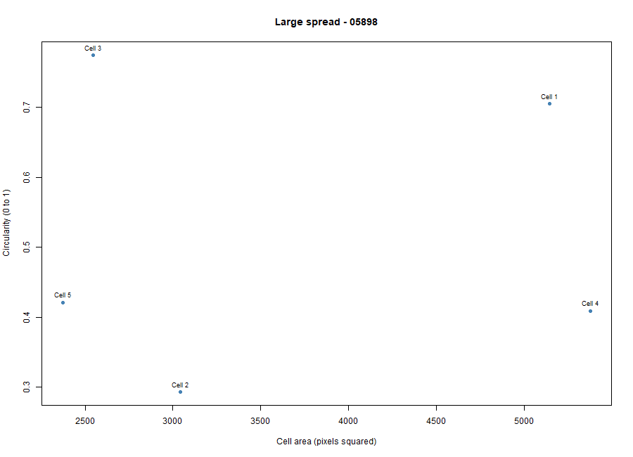
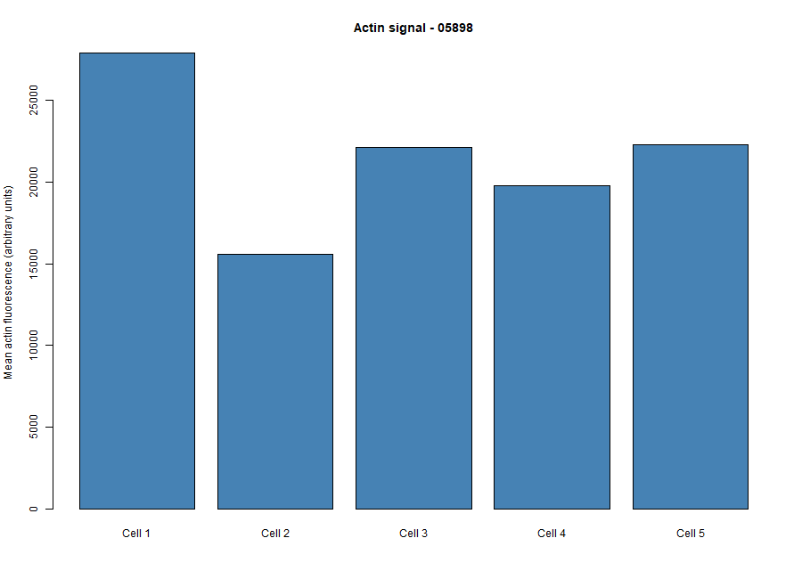
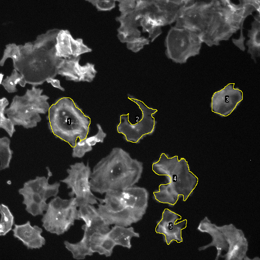

# Cytoskeleton and Cell Morphology (BBBC018)

**Student ID:** 202400768

**Chosen phenotype (my visual classification):** Large spread

**Image field ID:** 05898

**Actin file:** 05898-actin.DIB

**DNA file:** 05898-DNA.DIB

**Dataset:** https://bbbc.broadinstitute.org/BBBC018

**Download:** https://data.broadinstitute.org/bbbc/BBBC018/BBBC018_v1_images.zip

## Fiji steps
1. Opened 05898-actin.DIB (measured) and 05898-DNA.DIB (used only as a visual guide for nuclei) in Fiji.
2. Set Measurements: Area, Mean gray value, Shape descriptors, Display label.
3. Traced five isolated cells with the Freehand tool and added them to the ROI Manager.
4. Measured the cells and saved the results as data/fiji_results.csv.

## Plots

Area vs circularity: “Larger cells were not necessarily rounder. Cells 2, 4 and 5 had low circularity, while Cells 1 and 3 were closer to round.”

Actin intensity: “Mean actin signal varied between cells in field 05898 (arbitrary fluorescence units).”

Measured cells: five traced cells in field 05898 (actin channel), numbered 1 to 5.

## Answers

1. I chose the Large spread phenotype. In field 05898 many cells are big and flat, with broad, ruffled edges and actin staining across most of the cell body, and my five cells had areas of about 2,400 to 5,400 px² (mean about 3,700 px²). This is my own visual classification, not a verified label.

2. My five cells were not strongly elongated, because every aspect ratio was close to 1 (1.21 to 1.38, mean 1.30). They were also not very round, because the mean circularity was only 0.52 and ranged from 0.29 (Cell 2) to 0.78 (Cell 3). Cells 2, 4 and 5 had low circularity because of ruffled edges and a curved tail, not because they were long.

3. Actin filaments form a network under the plasma membrane (the cell cortex) that gives the cell its shape and mechanical support. During movement, actin polymerizes at the leading edge to push out protrusions such as lamellipodia and filopodia, and myosin contraction and attachment to the surface help pull the cell forward (Karp, Chapter 9).

4. Speed is distance divided by time, and one fixed image captures only one moment, so it has no time information. These cells were also fixed and stained, so they were not moving, and measuring speed would need images taken at several time points.

## Data credit
We used image set BBBC018v1 from the Broad Bioimage Benchmark Collection (Ljosa et al., Nature Methods, 2012).
